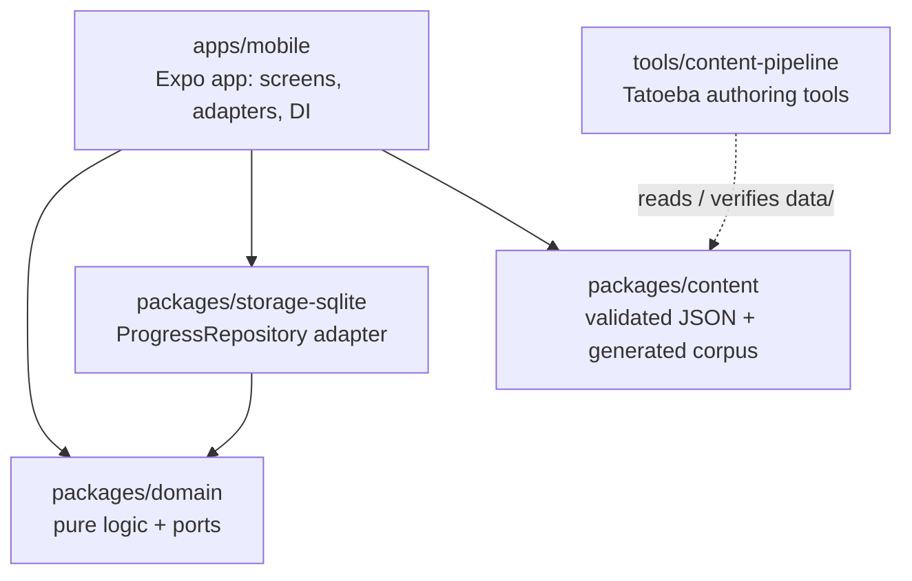

# English Learn

An offline-first English course for Spanish speakers, for **web and Android from one TypeScript
codebase**. No accounts, no network and no AI at runtime: content is static, validated in CI and
bundled with the app.

<!-- CI badge: fill in OWNER once the repository is published on GitHub.
[](https://github.com/OWNER/english-learn/actions/workflows/ci.yml)
-->

| At a glance  |                                                                                   |
| ------------ | --------------------------------------------------------------------------------- |
| Stack        | Expo SDK 58 · React Native 0.88 · React 19 · TypeScript · expo-router · SQLite    |
| Architecture | pnpm monorepo · hexagonal (ports & adapters) · screaming architecture             |
| Quality      | TDD · 592 unit/integration tests · 12 Playwright e2e specs on Chromium + WebKit   |
| Delivery     | GitFlow · Conventional Commits · GitHub Actions (format, lint, types, tests, e2e) |
| Version      | 0.1.0 (MVP), see [CHANGELOG](CHANGELOG.md)                                        |

## Contents

- [Features](#features-mvp)
- [Architecture](#architecture)
- [Key engineering decisions](#key-engineering-decisions)
- [Testing](#testing)
- [Content and licensing](#content-and-licensing)
- [Getting started](#getting-started)
- [Roadmap](#roadmap)
- [License](#license)

## Features (MVP)

- **Adaptive placement test**: up to 20 questions, chosen one by one for maximum information,
  that suggest a starting CEFR level (A1 to C1).
- **Lessons with 6 written exercise types**: vocabulary, cloze, word order, translation choice,
  reading comprehension and free-text translation. Free text is graded with typo and
  contraction tolerance (`correct` / `almost` / `wrong`).
- **Spaced repetition (SM-2)**: a daily review of due items, scheduled per item.
- **Progress**: XP, daily streak, placement level and completed lessons on the home screen.
- **Fully offline**: progress lives in SQLite on the device (WebAssembly + OPFS on web).
- **Content**: A2 and B1 courses, plus a placement bank covering A1 to C1.

| Content                | A2  | B1  | Total |
| ---------------------- | --- | --- | ----- |
| Topics                 | 10  | 11  | 21    |
| Lessons                | 20  | 22  | 42    |
| Exercises              | 139 | 154 | 293   |
| Items (words, phrases) | 115 | 133 | 248   |
| Reading passages       | 10  | 12  | 22    |

Placement bank: 65 questions, 13 per level from A1 to C1.

## Architecture



| Package                                                        | Role                                                                                     |
| -------------------------------------------------------------- | ---------------------------------------------------------------------------------------- |
| [`packages/domain`](packages/domain/README.md)                 | SRS, answer matching, scoring, streak, placement (CAT). Zero dependencies, no I/O.       |
| [`packages/content`](packages/content/README.md)               | JSON lessons and exercises, Zod schemas, semantic validation, generated corpus.          |
| [`packages/storage-sqlite`](packages/storage-sqlite/README.md) | SQLite implementation of the domain's `ProgressRepository` port, with migrations.        |
| [`apps/mobile`](apps/mobile/README.md)                         | Expo app (Android + web): routes, feature screens, infrastructure wiring.                |
| [`tools/content-pipeline`](tools/content-pipeline/README.md)   | Authoring-time CLI: shortlists Tatoeba sentences and verifies attributions. Never ships. |

**Hexagonal.** The domain owns the ports (`Clock`, `ProgressRepository`) and never touches I/O;
time and randomness are always injected. `storage-sqlite` and the app's `infrastructure/` are the
adapters, wired through a React context (`AppServicesProvider`), so tests swap in in-memory fakes
and a deterministic random source.

**Screaming architecture.** Folders are named after what the app does, not the framework:
`domain/src/{srs,placement,scoring,streak,answer-matching}` and
`mobile/src/features/{home,lesson,review,placement,about}`. Expo-router's `src/app/` only holds
thin route files.

**Container / presentational.** Each feature screen has a container that loads data and
dispatches, and a view that only renders props. Feature logic (grading, the session reducer,
SM-2 updates) lives in pure `model/` modules with their own unit tests.

## Key engineering decisions

| Decision                                  | Why                                                                                                                                                                                                                            |
| ----------------------------------------- | ------------------------------------------------------------------------------------------------------------------------------------------------------------------------------------------------------------------------------ |
| Static, validated content with a CI gate  | No AI or server at runtime. Zod schemas plus 12 corpus-wide semantic rules (references, levels, cloze shape, word-order solvability) fail CI on malformed content.                                                             |
| Generated corpus module                   | `build:corpus` emits a committed TypeScript module of static JSON imports. The app imports `@english-learn/content/corpus`, so Zod stays out of the bundle; CI fails if the generated file is stale.                           |
| Pure, dependency-free domain              | Deterministic logic (injected clock and rng) is fast to test and portable to a future backend.                                                                                                                                 |
| SM-2 grade from correctness + latency     | Learners never self-rate. Wrong → 1, almost → 3, correct but slower than the type's expected time → 4, correct on time → 5.                                                                                                    |
| Replay counts as practice                 | Replaying a lesson before its items are due leaves passing items unchanged (no inflated intervals); a wrong answer still counts as a lapse.                                                                                    |
| 3PL CAT with EAP estimation               | Fixed guessing `c = 1/options` fits multiple choice; EAP over a θ grid is stable with few answers. **Caveat:** difficulties are CEFR-derived priors, not calibrated, so the result is a starting level, not a certified score. |
| Atomic session save                       | Finishing a lesson writes review states, XP and streak in one SQLite transaction: all or nothing, so a failed save can simply be retried.                                                                                      |
| expo-sqlite on web via WASM + OPFS        | One storage adapter for Android and web. It needs `SharedArrayBuffer`, so the host must send COOP `same-origin` and COEP `require-corp` (`credentialless` is not supported by Safari).                                         |
| E2E clock override kept out of production | E2E tests jump days with `?today=`; the code only exists when built with `EXPO_PUBLIC_E2E=1`, and a CI script fails if it appears in the production bundle.                                                                    |

Package READMEs hold the details (algorithms, rules, error handling).

## Testing

Written test-first (TDD). Numbers from `pnpm test` and `playwright test --list` at v0.1.0:

| Package                   | Runner                                 | Tests                                     |
| ------------------------- | -------------------------------------- | ----------------------------------------- |
| `packages/domain`         | Vitest                                 | 231                                       |
| `packages/content`        | Vitest                                 | 123                                       |
| `packages/storage-sqlite` | Vitest (real SQLite via `node:sqlite`) | 25                                        |
| `tools/content-pipeline`  | Vitest (fixtures, no network)          | 20                                        |
| `apps/mobile`             | Jest + React Native Testing Library    | 193                                       |
| `apps/mobile` e2e         | Playwright on Chromium + WebKit        | 12 specs (24 runs) against the web export |

CI (`.github/workflows/ci.yml`) runs on pushes and pull requests to `main` and `develop`:
format, lint, typecheck, unit tests, content validation, corpus freshness, production web export
(with the bundle check) and the Playwright suite.

## Content and licensing

- **Original content** is written for this project. No copyrighted word lists or textbook
  material are copied.
- **Tatoeba sentences** (113 of 293 exercises) are used under
  [CC BY 2.0 FR](https://creativecommons.org/licenses/by/2.0/fr/). Each one records the sentence
  id and author in its `source` field, a pipeline check verifies the English text matches the
  attributed sentence exactly, and the app's About screen credits Tatoeba with the license.
  Spanish translations are our own.
- **Conventions**: American English spelling; neutral Spanish for UI and prompts (no voseo).

## Getting started

**Prerequisites:** Node.js 24 (see `.nvmrc`) and pnpm through Corepack.

```sh
corepack enable
pnpm install

# Run the app
pnpm --filter @english-learn/mobile web       # web dev server
pnpm --filter @english-learn/mobile android   # Android emulator or device (Expo)

# Checks (the same as CI's check job)
pnpm check                 # format, lint, typecheck, tests, content validation, corpus check
pnpm test                  # unit and integration tests only
pnpm validate:content      # validate packages/content/data

# Web build and e2e
pnpm --filter @english-learn/mobile export:web   # production export to apps/mobile/dist
pnpm --filter @english-learn/mobile exec playwright install chromium webkit   # first time only
pnpm --filter @english-learn/mobile e2e:web
```

Android APK/AAB builds (EAS or local Gradle) and web hosting headers are covered in
[apps/mobile/README.md](apps/mobile/README.md#android-builds).

## Roadmap

**Phase 1.5: listening and speaking (still offline)**

- Text-to-speech for prompts and sentences, dictation and listening exercises.
- Dialogues and guided writing.
- Speaking practice through the device's native speech recognition.

**Phase 2: optional backend**

- FastAPI + PostgreSQL to sync progress across devices.
- Downloadable content packs.
- Calibrate placement item difficulties (IRT) from real response data.

**Known limitations** are listed in
[apps/mobile/README.md](apps/mobile/README.md#known-limitations) (for example, a reading exercise
grades all its items with one verdict, and the web app works in one tab at a time).

## License

- **Code**: License: to be decided.
- **Content**: sentences from [Tatoeba](https://tatoeba.org) are licensed CC BY 2.0 FR and
  credited as described above.
